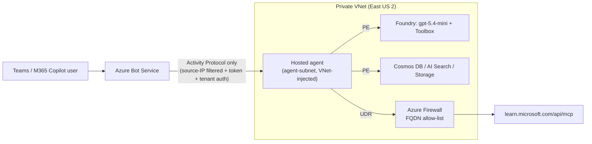

# m365-admin-foundry-copilot

This proof of concept for **Johnson & Johnson** shows how to:

1. Run a **Microsoft Foundry hosted agent** (Microsoft Agent Framework) in a **fully private network** with Standard Agent Setup: BYO VNet, private endpoints, customer-owned Cosmos DB, AI Search, and Storage.
2. Give the agent an **out-of-the-box MCP tool**: the Microsoft Learn MCP server, exposed through a Foundry Toolbox and governed by an Azure Firewall FQDN allow-list.
3. **Publish the agent to Microsoft 365 Copilot and Teams** while the Foundry project keeps public network access disabled.
4. **Govern** the agent by controlling who can publish it, who approves it, who can use it, how many people can use it, and how to stop it.

| Document | Contents |
|---|---|
| [docs/networking.md](docs/networking.md) | Architecture diagram, address plan, inbound and outbound traffic flows, what is public and private, and verification steps |
| [docs/governance.md](docs/governance.md) | Four-layer governance model, M365 admin approval and audience scoping, Teams availability, monitoring, kill switches, and the demo script |
| [docs/jnj-landing-zone.md](docs/jnj-landing-zone.md) | Mapping to JNJ's hub-spoke landing zone, central DNS, CI/CD, the security exception to approve, RACI, and the rollout path |
| [docs/troubleshooting.md](docs/troubleshooting.md) | Issues found while building the POC, with evidence and fixes, including the required `?api-version=v1` on the bot endpoint, Teams availability, cold start, and the open M365 Copilot rendering issue |
| [docs/demo-video-script.md](docs/demo-video-script.md) | Shot-by-shot recording guide and AI voiceover script for a showcase video, plus Clipchamp assembly steps |

**Status:** The agent works end to end in **Microsoft Teams** from the private network. In **M365 Copilot**, every message reaches the agent and an answer is generated, but Copilot shows an empty reply. An isolation test with a minimal prompt agent showed the same behavior, so the issue is in the M365 Copilot channel path for private-network Foundry agents, not in this agent. See [troubleshooting](docs/troubleshooting.md#open-issue-m365-copilot-doesnt-render-the-final-answer).

## Architecture at a glance



## What gets deployed

Resource group: `rg-jnj-foundry-m365-poc` in **East US 2**

| Layer | Resources | Source |
|---|---|---|
| Network | VNet `10.50.0.0/16`; agent, private endpoint, jumpbox, and firewall subnets; NSGs; forced-tunnel route table; Azure Firewall Basic with policy; Log Analytics; jumpbox VM with no public IP and a managed identity | [infra/network.bicep](infra/network.bicep) |
| Foundry Standard Agent Setup | Foundry account with public network access disabled and agent subnet injection; project; `gpt-5.4-mini`; Cosmos DB; AI Search; Storage; Application Insights with AMPLS; private endpoints; private DNS zones; capability host. AI Search is BYO in Central US because East US 2 lacked Standard capacity. Use `deploy-infra.ps1 -AiSearchResourceId`. | [infra/foundry/](infra/foundry/), a pinned copy of the official [template 15](https://github.com/microsoft-foundry/foundry-samples/tree/main/infrastructure/infrastructure-setup-bicep/15-private-network-standard-agent-setup), parameterized by [infra/foundry.bicepparam](infra/foundry.bicepparam) |
| Agent | Foundry Toolbox `learn-tools` with the Microsoft Learn MCP server, and hosted agent `jnj-azure-advisor` using Agent Framework and source-code deployment | [agent/](agent/) |
| Publishing | Azure Bot Service resource with the Teams channel and public network access disabled | [infra/bot-service.bicep](infra/bot-service.bicep) |

## Prerequisites

- PowerShell 7, Azure CLI 2.60 or later, and Bicep CLI
- Signed in with `az login` to the target tenant and subscription
- **Owner** on the subscription. The scripts grant the needed Foundry data-plane roles.
- **Global Administrator**, or **AI Administrator** plus **Teams Administrator**, in Microsoft 365 to approve and scope the agent
- Registered resource providers: `Microsoft.CognitiveServices`, `Microsoft.App`, `Microsoft.ContainerService`, `Microsoft.Network`, `Microsoft.DocumentDB`, `Microsoft.Search`, `Microsoft.Storage`, `Microsoft.BotService`, and `Microsoft.Compute`

You don't need `azd` locally. It runs on the jumpbox inside the VNet.

## Runbook

```powershell
# 1. Network + private Foundry Standard Agent Setup (~40 min). Use -WhatIf first to preview.
#    Use -SkipNetwork to resume after the network layer succeeded.
./scripts/deploy-infra.ps1

# 2. Prove the isolation boundary (public = blocked, VNet = private IPs, egress via firewall)
./scripts/verify-network.ps1

# 3. Deploy the Learn MCP toolbox + hosted agent from inside the VNet, then smoke-test it
./scripts/deploy-agent.ps1

# 4. Create the pilot audience group used for governance
./scripts/create-pilot-group.ps1

# 5. Publish to Microsoft 365 / Teams (Bot Service + public Activity route + Tenant-scope publish)
./scripts/publish-agent.ps1 -PublishScope Tenant

# 6. (Optional) Use the Foundry portal from your laptop: P2S VPN (Entra ID) + DNS Private Resolver
./scripts/setup-vpn.ps1   # then import .poc/vpn/azurevpnconfig.xml into Azure VPN Client and connect
```

Then complete the governance steps:

1. Open the [M365 admin center Requests page](https://admin.cloud.microsoft/?#/agents/all/requested) and select **JNJ Azure Advisor** > **Publish to store**.
2. Set the audience to `sg-jnj-azure-advisor-pilot`.
3. In the [Teams admin center](https://admin.teams.microsoft.com/), go to **Teams apps** > **Manage apps** > **JNJ Azure Advisor** > **Users and groups**, and add the same group.
4. In Teams, open **Apps** > **Built by your org** > **JNJ Azure Advisor** and ask a question.

See [docs/governance.md](docs/governance.md#demo-script-governance) for the full demo.

### How the private data plane is reached

The Foundry project rejects public callers, so creating toolboxes, uploading agent code, invoking the agent, and calling the publish API must originate inside the VNet. The scripts ship the code to the jumpbox and run it through **Azure Run Command**, which uses the Azure management plane. As a result:

- The jumpbox has **no public IP and no inbound ports**.
- `azd` on the jumpbox authenticates with the VM's **managed identity**.
- Publish calls use the admin's short-lived `https://ai.azure.com` token, passed as an encrypted Run Command protected parameter.

In JNJ's environment, use an ExpressRoute- or VPN-connected workstation or an in-VNet CI/CD runner. See [docs/jnj-landing-zone.md](docs/jnj-landing-zone.md).

## Update the agent

- **Code or prompt change:** Edit `agent/src/jnj-azure-advisor/` and run `./scripts/deploy-agent.ps1`. This creates a new agent version. The published Teams and Copilot agent serves the active version without republishing or re-approval.
- **Display metadata change:** Run `./scripts/publish-agent.ps1 -AppVersion 1.0.1`. The change appears as **Pending update** in the M365 admin center.
- **New tool:** Add it to the `learn-tools` toolbox in `agent/azure.yaml`, add its FQDN to `agentAllowedFqdns` in `infra/network.bicep`, and then redeploy both.

## Cost and cleanup

The main running costs are Azure Firewall Basic, AI Search Standard, the jumpbox VM, and Cosmos DB. If you deploy laptop access, the VPN Gateway (`VpnGw1AZ`) and DNS Private Resolver inbound endpoint add roughly $320 per month. Model usage is pay-per-token. To stop the VM when you aren't demonstrating the solution, run:

```powershell
az vm deallocate -g rg-jnj-foundry-m365-poc -n vm-jnjm365-jumpbox
```

To tear down the environment, remove the agent from the M365 admin center and then delete and purge the Foundry account **before** deleting the VNet. The capability host keeps a service association on the agent subnet until the account is purged. Follow the [template 15 cleanup guidance](https://github.com/microsoft-foundry/foundry-samples/tree/main/infrastructure/infrastructure-setup-bicep/15-private-network-standard-agent-setup#account-deletion-prerequisites-and-cleanup-guidance), then run:

```powershell
az cognitiveservices account delete -g rg-jnj-foundry-m365-poc -n <account>
az cognitiveservices account purge -g rg-jnj-foundry-m365-poc -n <account> -l eastus2
# wait ~20 minutes for the subnet association to clear
az group delete -n rg-jnj-foundry-m365-poc --yes
```

## Repository layout

```text
agent/                     azd project: Learn MCP toolbox + hosted agent (Agent Framework)
infra/network.bicep        VNet, NSGs, Azure Firewall Basic + policy, UDR, jumpbox
infra/foundry/             Pinned copy of foundry-samples template 15 (MIT)
infra/foundry.bicepparam   POC parameters for template 15 (existing VNet, gpt-5.4-mini)
infra/bot-service.bicep    Azure Bot Service for M365/Teams publishing
infra/vpn.bicep            Optional P2S VPN (Entra ID) + DNS Private Resolver for laptop/portal access
scripts/                   Workstation orchestration (PowerShell 7)
scripts/jumpbox/           Scripts executed inside the VNet via Run Command
tools/demo-video/          Showcase video builder (ffmpeg + Azure AI Speech voiceover + branding)
docs/                      Networking, governance, and JNJ landing-zone guidance
```
