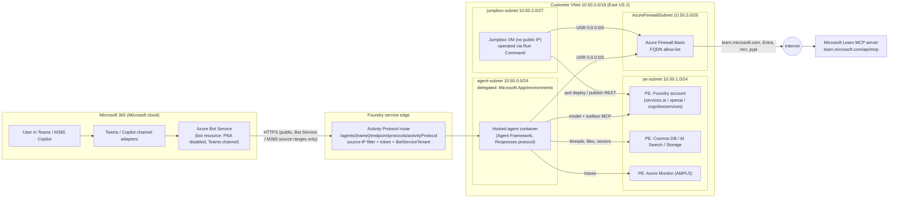
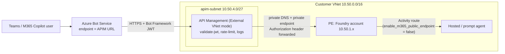

# How this works: networking

This POC runs a Microsoft Foundry hosted agent in a fully private Azure environment and publishes it to Microsoft 365 Copilot and Teams. Microsoft 365 traffic can enter in one of two ways:

- **Option 1, direct (default):** Bot Service calls Foundry's service-managed, **source-IP-filtered Activity Protocol route** (`enable_m365_public_endpoint=true`). That route is the only thing Microsoft 365 can call; every other Foundry API remains private. See [flow 1](#1-teams--microsoft-365-copilot--agent-inbound).
- **Option 2, through Azure API Management:** Bot Service calls a customer-owned APIM gateway. APIM validates the token and forwards to the Activity route over the **private endpoint**, so `enable_m365_public_endpoint=false` and Foundry has no public route at all. See [Option 2](#option-2-teams--microsoft-365--apim--agent-inbound).

## Architecture



## Address plan

| Subnet | CIDR | Purpose |
|---|---|---|
| `agent-subnet` | `10.50.0.0/24` | Delegated to `Microsoft.App/environments`. Foundry injects hosted-agent compute and capability-host traffic here. One Foundry account per subnet. |
| `pe-subnet` | `10.50.1.0/24` | Private endpoints for Foundry, Cosmos DB, AI Search, Storage, and Azure Monitor Private Link Scope. |
| `jumpbox-subnet` | `10.50.2.0/27` | Admin VM used for data-plane operations because the Foundry project rejects public callers. |
| `AzureFirewallSubnet` | `10.50.3.0/26` | Azure Firewall Basic data plane. Private IP `10.50.3.4` is the next hop for `0.0.0.0/0`. |
| `AzureFirewallManagementSubnet` | `10.50.3.64/26` | Required by Azure Firewall Basic for its management traffic. |
| `apim-subnet` | `10.50.4.0/27` | Optional (Option 2). API Management in External VNet mode, with an NSG for the APIM management rules: inbound 443 Internet, 3443 ApiManagement, and 6390 AzureLoadBalancer; outbound Storage, Sql, AzureKeyVault, and AzureMonitor. |

All subnets set `defaultOutboundAccess: false`, so internet egress is available only through the firewall route.

## Traffic flows

### 1. Teams / Microsoft 365 Copilot → agent (inbound)

1. The user sends a message in Teams or Microsoft 365 Copilot.
2. The channel adapter forwards it to the Azure Bot Service resource. Its messaging endpoint is the agent's Activity Protocol URL **including `?api-version=v1`**. Without the API version, the request doesn't match the filtered route and receives the account-wide 403. See [troubleshooting](troubleshooting.md#1-m365-or-teams-calls-blocked-with-a-generic-403-missing-api-version-on-the-bot-endpoint).
3. The Teams and Copilot channel calls `https://<account>.services.ai.azure.com/api/projects/<project>/agents/<agent>/endpoint/protocols/activityProtocol?api-version=v1` over the public internet. This POC observed source IPs `52.112.x` and `52.123.x`.
4. The Foundry edge accepts the request **only** if all of the following checks pass:
   - **Source IP:** The request originates from Azure Bot Service or Microsoft 365 source ranges. Foundry determines the IP at its edge, so forwarding headers can't spoof it, and it denies requests without a source IP.
   - **Token:** The signed Bot Framework channel token is valid for the agent's identity.
   - **Authorization scheme:** `BotServiceTenant` requires the caller to be in this tenant. `BotServiceRbac` also requires Foundry RBAC on the project.
5. Foundry routes the authorized activity to the active agent version that runs in `agent-subnet`.

No public IP, DNAT, load balancer, certificate, or inbound firewall rule exists in the customer VNet. The Activity route is a service-managed exception. Microsoft 365 doesn't support Private Link, so this is the documented way to reach a private-network agent from Microsoft 365.

### Option 2: Teams / Microsoft 365 → APIM → agent (inbound)

Option 2 replaces the Foundry-edge exception with a gateway that JNJ owns. The Foundry account has no public route at all; the only public entry point is the APIM gateway.



1. Publishing is the same as Option 1: Tenant scope, `BotServiceTenant`, and M365 admin approval. The only difference is the Bot Service messaging endpoint, `https://apim-jnjm365.azure-api.net/m365/<agent>/activity`.
2. The APIM per-agent operation ([apim-agent-route.bicep](../infra/apim-agent-route.bicep)) runs these steps:
   - **`validate-jwt`:** Accepts only a Bot Framework or tenant-issued token whose audience is **this agent's identity client ID**. Anything else gets 401 at the gateway and never reaches Foundry.
   - **`rate-limit`:** Defaults to 120 calls per minute per agent.
   - **`rewrite-uri`:** Rewrites to `/<agent>/endpoint/protocols/activityProtocol?api-version=v1`.
3. APIM resolves `<account>.services.ai.azure.com` through the VNet-linked private DNS zone and calls the **private endpoint**. Foundry logs these calls from `10.50.4.x`.
4. APIM forwards the original `Authorization` header unchanged. Foundry therefore still validates the token and applies `BotServiceTenant`, as defense in depth.
5. The reply goes back to Teams through the Bot Framework connector, the same as in Option 1.

Bot Service can't send an APIM subscription key, so the API is keyless and **the JWT is the credential**. Each agent gets its own operation, audience, and rate limit, which means one APIM instance can front every published agent.

**Evidence from this POC** (`jnj-advisor-apim-tenant`, Tenant scope, 2026-10-20):

| Time (UTC) | Log | Source | Result |
|---|---|---|---|
| 01:21:04 | `ApiManagementGatewayLogs` | `52.112.113.207` (Teams) | 202, backend 202 |
| 01:21:06 | Foundry `Projects_Wildcard_Post` | `10.50.4.x` (APIM subnet) | 202 |
| 01:21:27 | Foundry `create_response` | (agent) | 200; the answer was shown in Teams |
| (test) | APIM, with no token or a forged token | internet | 401 at APIM; Foundry never called |

**Choosing an option**

| Consideration | Option 1: Direct | Option 2: APIM |
|---|---|---|
| Foundry has any public route | Yes: the filtered Activity route | **No** |
| Who controls the public entry point | Microsoft (Foundry edge) | **JNJ** (APIM policies, WAF, logs) |
| Per-agent throttling or kill switch outside Foundry | No | **Yes** |
| Fits a "no PaaS public endpoints" policy | Needs an exception | Standard "API gateway in the DMZ" pattern |
| Moving parts and cost | Fewest | Plus APIM. For production use Premium or Standard v2 with VNet integration and availability zones; optionally put Application Gateway WAF in front. |
| Documented by Microsoft Learn | Yes ([publish-copilot-virtual-network](https://learn.microsoft.com/azure/foundry/agents/how-to/publish-copilot-virtual-network)) | Composed pattern. Validated in this POC with Teams and both Tenant and Shared scope. |

> **Production notes:** The APIM gateway is internet-facing, and scanners will probe it. Undefined paths return 404 and never reach Foundry. Use a custom domain and certificate. Consider restricting `apim-subnet` inbound 443 to the Bot Service and Microsoft 365 ranges after you validate the source ranges in your tenant; this POC observed `52.112.x` and `52.123.x`. Keep `api-version=v1` on the backend rewrite.

### 2. Agent → model, toolbox, and state (private)

| Destination | Path |
|---|---|
| Model (`gpt-5.4-mini`) | Private endpoint in `pe-subnet` |
| Foundry Toolbox MCP endpoint (`/toolboxes/learn-tools/mcp`) | Private endpoint in `pe-subnet` |
| Threads (Cosmos DB), files (Storage), vectors (AI Search) | Private endpoints. These BYO resources provide the Standard Agent Setup data plane. |
| Traces (Application Insights) | Azure Monitor Private Link Scope private endpoint |

> **Deployment note:** East US 2 had no Azure AI Search Standard capacity during deployment, so the POC uses a BYO Search service in **Central US** (`jnjm365srchcus`) with public network access disabled. Its private endpoint remains in the East US 2 `pe-subnet` (`10.50.1.9`). Learn allows dependent resources to be in a different region from the VNet; only the Foundry account must match the VNet region.

Private DNS zones (`privatelink.services.ai.azure.com`, `privatelink.openai.azure.com`, `privatelink.documents.azure.com`, and others) are linked to the VNet, so the same public FQDNs resolve to `10.50.1.x` inside the network.

### 3. Agent → MCP server (governed egress)

Toolbox MCP tool traffic flows through the project's delegated subnet ([toolbox network isolation](https://learn.microsoft.com/azure/foundry/agents/how-to/tools/toolbox-network-isolation)). The route table sends it to Azure Firewall, where an application rule allows only these destinations:

| Purpose | Allowed FQDNs or service tags |
|---|---|
| MCP tool | `learn.microsoft.com` |
| Identity | `login.microsoftonline.com`, `*.login.microsoftonline.com`, `login.microsoft.com`, `*.login.microsoft.com`, `*.identity.azure.net`, and the `AzureActiveDirectory` service tag |
| Hosted-agent runtime and source-code deployment | `mcr.microsoft.com`, `*.data.mcr.microsoft.com`, `packages.aks.azure.com`, `acs-mirror.azureedge.net`, `pypi.org`, `files.pythonhosted.org`, and the `MicrosoftContainerRegistry` and `AzureFrontDoor.FirstParty` service tags |
| Agent 365 observability | `agent365.svc.cloud.microsoft` |

The firewall denies everything else. Firewall logs go to `log-jnjm365-net`, so security teams can see each allowed or denied call:

```kusto
AZFWApplicationRule
| where TimeGenerated > ago(1h)
| project TimeGenerated, SourceIp, Fqdn, Action, Rule, RuleCollection
| order by TimeGenerated desc
```

Adding a tool is therefore a two-part change: a toolbox change in Foundry and a firewall allow-list change owned by the network team.

Observed in this POC after one agent invocation:

| Source (agent-subnet) | Action | Destination | Rule |
|---|---|---|---|
| `10.50.0.111` | Allow | `learn.microsoft.com` | `agent-to-approved-fqdns` (MCP tool call) |
| `10.50.0.234` | Allow | `agent365.svc.cloud.microsoft` | `agent-to-approved-fqdns` (observability) |
| `10.50.0.197` | Allow | Entra ID IPs | `agent-to-platform-tags` (token acquisition) |
| `10.50.0.234` | **Deny** | `settings.sdk.monitor.azure.com` | Not allow-listed. Telemetry still flows privately through AMPLS. |

### 4. Builders and admins → Foundry (management vs. data plane)

| Plane | Example | Reachable from |
|---|---|---|
| ARM management (`management.azure.com`) | Create accounts, Bot Service, role assignments | Anywhere with Azure RBAC |
| Foundry data plane (`*.services.ai.azure.com`) | Create agent versions, toolboxes, invoke, publish | **Only** the VNet: jumpbox in this POC; ExpressRoute, VPN, or an in-VNet CI/CD runner at JNJ |

The POC operates the jumpbox through **Azure Run Command**, which uses the management plane. Therefore, the VM has no public IP and no inbound NSG rules. Bastion is optional.

### 5. Developer laptop → Foundry portal (P2S VPN)

The Foundry portal (`ai.azure.com`) is a public web app. Your **browser** calls the project data plane directly, so the browser must reach the private endpoint. `infra/vpn.bicep` (`./scripts/setup-vpn.ps1`) adds a small **hub-spoke** access layer:

| Component | Detail |
|---|---|
| Hub VNet `vnet-jnjm365-hub` `10.60.0.0/24` (Central US) | Contains `GatewaySubnet` `10.60.0.0/27` with VPN Gateway `VpnGw1AZ` (point-to-site OpenVPN). It peers with the spoke through **gateway transit**, so clients receive `172.16.201.0/24` and a route to the spoke `10.50.0.0/16`. The gateway runs in a separate hub region because zone-redundant gateway builds repeatedly failed in East US 2 for this subscription. |
| Microsoft Entra ID authentication | Uses the Microsoft-registered Azure VPN Client app (`c632b3df-fb67-4d84-bdcf-b95ad541b5c8`), so you don't need an app registration or certificates. Entra Conditional Access applies at sign-in. |
| `dns-inbound-subnet` `10.50.3.160/28` (spoke) | Azure DNS Private Resolver inbound endpoint. The client profile adds NRPT rules so names under `.services.ai.azure.com`, `.openai.azure.com`, `.cognitiveservices.azure.com`, `.search.windows.net`, `.documents.azure.com`, and `.blob.core.windows.net` resolve through the VNet's private DNS zones. |

Split tunneling is the default: only VNet traffic and DNS for those suffixes use the tunnel. At JNJ, ExpressRoute and the hub's DNS Private Resolver or conditional forwarders provide this access path. See [jnj-landing-zone.md](jnj-landing-zone.md).

## Public vs. private

| Endpoint | Exposure |
|---|---|
| Foundry account and project APIs (agents, responses, toolboxes, files) | **Private.** `publicNetworkAccess: Disabled`; public callers receive 403. |
| Activity Protocol route for the published agent | **Option 1: public, filtered.** Only Bot Service and Microsoft 365 source ranges with a valid token and authorization scheme can call it. **Option 2: off** (`enable_m365_public_endpoint=false`); reached only through the private endpoint. |
| APIM gateway (Option 2 only) | **Public, policy-governed.** It requires a valid Bot Framework JWT for the agent's identity, is rate-limited, and logs to Log Analytics. |
| Cosmos DB, AI Search, Storage | **Private.** Public network access is disabled. |
| Application Insights ingestion | **Private** through AMPLS. |
| Azure Bot Service resource | Microsoft-managed. `publicNetworkAccess: Disabled`; only the Teams channel is enabled. |
| Hosted-agent egress | **Firewall allow-list** only |

## Verify it yourself

```powershell
./scripts/verify-network.ps1
```

The script confirms the following:

- `publicNetworkAccess` is `Disabled` on Foundry, Cosmos DB, AI Search, and Storage.
- A call from the internet to the project API is rejected.
- From inside the VNet, every service FQDN resolves to a `10.50.1.x` private IP, and the project API returns 401 (reachable, authentication required).
- Jumpbox egress leaves through the firewall's public IP.

## References

- [Publish agents to Microsoft 365 and Teams by using the REST API](https://learn.microsoft.com/azure/foundry/agents/how-to/publish-copilot-virtual-network), including the network-path details in Step 5
- [Set up private networking for Foundry Agent Service](https://learn.microsoft.com/azure/foundry/agents/how-to/virtual-networks)
- [Standard agent setup](https://learn.microsoft.com/azure/foundry/agents/concepts/standard-agent-setup)
- [Network isolation for a toolbox](https://learn.microsoft.com/azure/foundry/agents/how-to/tools/toolbox-network-isolation)
- [Deploy a hosted agent from source code: firewall requirements](https://learn.microsoft.com/azure/foundry/agents/how-to/deploy-hosted-agent-code#firewall-requirements-for-private-virtual-networks)
